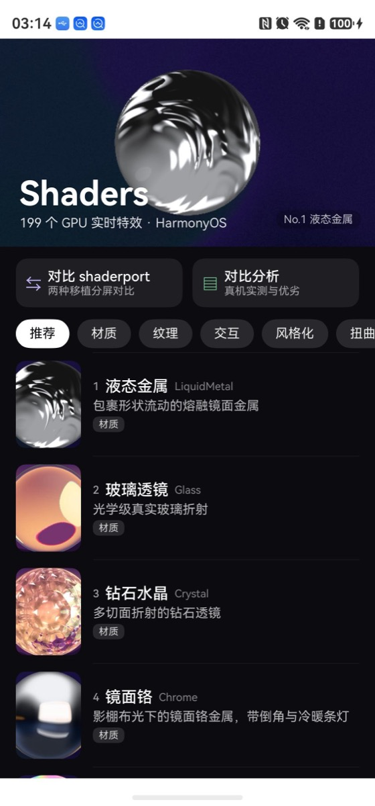
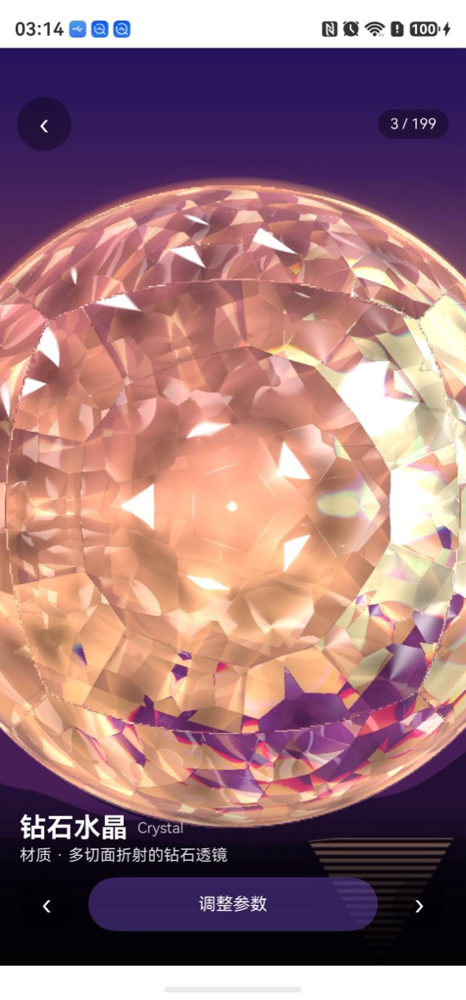
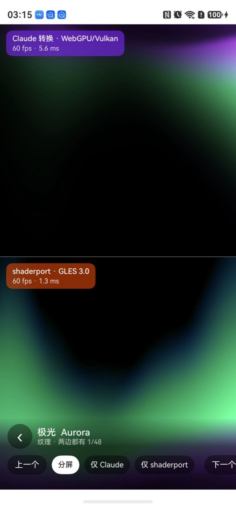
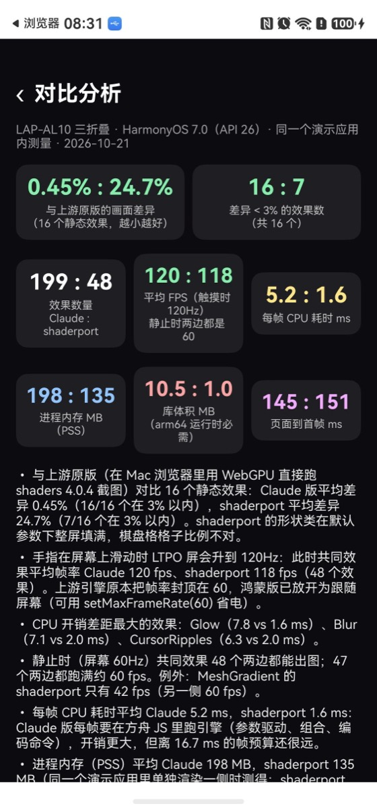

# webgpu-effects

> **鸿蒙上的 WebGPU 实时特效组件** — 199 个 GPU 效果（渐变、噪声、玻璃、金属、光影、流体、粒子、扭曲、转场、模糊、跟手效果），一个 ArkUI 组件即可使用。


> **主仓**：[GitHub `virg00/webgpu-effects`](https://github.com/virg00/webgpu-effects)；OHPM 包：`@virg00/webgpu-effects`。

`webgpu-effects` is an independent project. It is **not affiliated with, endorsed by, or sponsored by** Shader Effects Inc.
or the `shader-effects-inc/shaders` project. 本项目是独立的第三方项目，与上游没有任何组织关系，见 [与上游的关系](docs/provenance-and-naming.md)。

## 目录

1. [简介](#简介)
2. [真机效果](#真机效果)
3. [环境要求](#环境要求)
4. [安装](#安装)
5. [快速开始](#快速开始)
6. [组合与动态属性](#组合与动态属性)
7. [API 参考](#api-参考)
8. [效果目录](#效果目录)
9. [性能](#性能)
10. [与 shaderport 的对比](#与-shaderport-的对比)
11. [已知限制](#已知限制)
12. [从源码构建](#从源码构建)
13. [仓库结构](#仓库结构)
14. [许可](#许可)

## 简介

上游 [shaders](https://github.com/shader-effects-inc/shaders)（MIT，v4.0.4）是一个只支持 **WebGPU** 的效果库：着色器（WGSL）
在运行时由引擎组合生成，部分效果依赖计算着色器。鸿蒙上没有可用的 WebGPU：

- ArkWeb 实测 `navigator.gpu` 存在，但 **`requestAdapter()` 返回 null**（HarmonyOS 6.1 模拟器、7.0 真机均如此）；
- 原生侧只有 OpenGL ES 与 Vulkan。

`webgpu-effects` 的做法是**在原生层实现一套 WebGPU**，让上游引擎原样运行（Chrome 在安卓上也是用 Vulkan 实现 WebGPU 的）：

```
ShaderView (ArkUI)                 XComponent、触摸、布局、可见性
  └─ 上游引擎 (bundle.js)           组合器、TypeGPU、效果定义，运行在方舟 JS 引擎上
      ├─ runtime.js               window / document / rAF / 2D 画布 / 字体 / 图片 / 视频 / 摄像头 垫片
      └─ webgpu.js                navigator.gpu 与全部 GPU* 类
          └─ libwebgpu_effects.so NAPI ↔ webgpu.h
              └─ wgpu-native      Vulkan 后端，VK_OHOS_surface 输出到 XComponent
```

- **199 个效果**（上游 200 个，仅缺浏览器专属的 `HTMLInCanvas`），真机逐个验证可运行
- **与上游一致**：跑的就是上游引擎，16 个静态效果与上游原版（浏览器 WebGPU）平均像素差异 **0.45%**
- **完整能力**：任意图层组合、20 种混合模式、遮罩、属性驱动（自动动画 / 跟手 / 读取其它图层）、计算着色器模拟
- **外部输入**：图片（rawfile / https / 文件 / data URL）、视频（AVPlayer）、摄像头、文字
- **跟进上游**：`scripts/sync-upstream.sh` 一条命令同步新版本

## 真机效果

> LAP-AL10（三折叠，HarmonyOS 7.0）实拍。示例工程：[`app/entry`](app/entry)。

| 效果菜单 | 效果详情 | 与 shaderport 分屏对比 | 对比分析 |
|---|---|---|---|
|  |  |  |  |

## 环境要求

| 项 | 要求 |
|---|---|
| HarmonyOS | **API 24+**（compatibleSdkVersion 6.1.1(24)）；已在 API 26 真机验证 |
| 图形 | **Vulkan**（支持 `VK_OHOS_surface`） |
| ABI | arm64-v8a |
| 权限 | 库本身**不声明权限**；用 https 图片/视频需宿主声明 `ohos.permission.INTERNET`，用 `WebcamTexture` 需声明 `ohos.permission.CAMERA` |
| 模拟器 | 不建议：模拟器的 Vulkan 转译层对多数着色器会转换失败（见[已知限制](#已知限制)） |

## 安装

```bash
ohpm install @virg00/webgpu-effects
```

本地开发（HAR 源码）：

```json5
// entry/oh-package.json5
"dependencies": { "@virg00/webgpu-effects": "file:../webgpu-effects" }
```

## 快速开始

```ts
import { ShaderView, LinearGradient, CursorTrail, initShaders } from '@virg00/webgpu-effects';

// EntryAbility.onCreate：传入 Context（用于读取 rawfile 图片、相机等），调用一次即可
initShaders(this.context);

// 页面里：图层从下往上叠加，在 GPU 上混合
ShaderView({ layers: [
  LinearGradient({ colorA: '#0f172a', colorB: '#7c3aed', angle: 45 }),
  CursorTrail(),
] })
  .width('100%').height(256)
```

- 每个效果都是一个**带类型的工厂函数**（`LinearGradient(props?, children?)`），参数与上游组件一致，默认值相同。
- 改变 `layers` 时，只有参数变化的部分会增量推送，图层结构变化才会重建。
- 高频更新（拖动滑块、手势）用控制器：`controller.update('myLayer', { intensity: v })`。
- shaders.com 编辑器导出的预设 JSON：`ShaderView({ preset: json })`。

## 组合与动态属性

**效果作用于之前绘制的图层**，所以扁平堆叠就是默认用法：

```ts
ShaderView({ layers: [
  ImageTexture({ url: 'rawfile://hero.jpg', objectFit: 'cover' }),
  Blur({ intensity: 60 }),
  Vignette({ intensity: 0.8, radius: 0.6 }),
] })
```

只想作用于某几个图层时，把它们作为第二个参数传入：`Blur({ intensity: 30 }, [ImageTexture({ url })])`。

**每个图层都支持**：`id`、`blendMode`（normal / multiply / screen / overlay / softLight …共 20 种）、`opacity`、`visible`、
`maskSource` + `maskType`、`transform`、`boundingBox`、`flow`、`absolute`。

**动态属性**：在数值或坐标位置传一个驱动对象，无需写动画代码：

```ts
Circle({ radius: { type: 'auto-animate', mode: 'ping-pong', outputMin: 0.2, outputMax: 0.6, speed: 1 } })
Circle({ center: { type: 'mouse-position', smoothing: 0.12 } })          // 跟随手指
Blur({ intensity: { type: 'mouse', axis: 'x', outputMin: 0, outputMax: 40 } })
```

更多见 [使用指南](docs/usage-guide.md)。

## API 参考

| 接口 | 说明 |
|---|---|
| `ShaderView({ layers, preset, paused, interactive, pauseWhenHidden, colorSpace, toneMapping, controller, onReady, onShaderError })` | ArkUI 组件；`layers` 与 `preset` 二选一 |
| `ShaderController` | `update(id, props)` 增量改参数；`pause()` / `resume()`；`stats()` 返回 `{ fps, cpuMs }` |
| `initShaders(context)` | 绑定 Context（rawfile 图片、视频、相机需要），调用一次 |
| `setMaxFrameRate(fps)` | 帧率上限，默认 120（跟随屏幕）；设 60 可省电 |
| `isSupported()` | `Promise<boolean>`：当前设备能否创建 WebGPU 设备 |
| `setDebug(on)` | 引擎诊断输出到 hilog（GPU 错误、WGSL 编译失败） |
| `<Effect>(props?, children?)` | 199 个效果的工厂函数，返回 `ShaderNode`；参数类型 `<Effect>Props` |

图片 `url` 支持 `rawfile://path`、`https://…`、`file://…`（应用沙箱）与 `data:` URL。

## 效果目录

| 类别 | 数量 | 代表 |
|---|---|---|
| 材质 Shape Effects | 23 | LiquidMetal、Glass、Crystal、Chrome、Holographic、Nebula、Neon、Water、Frost |
| 纹理 Textures | 54 | Aurora、MeshGradient、Godrays、Plasma、Marble、FlowingGradient、各类噪声 |
| 交互 Interactive | 16 | Boids、Smoke、InkFlow、ReactionDiffusion、ParticleFlow、CursorRipples |
| 风格化 Stylize | 31 | Halftone、Ascii、VHS、CRTScreen、Glitch、Watercolor、LensFlare |
| 扭曲 Distortions | 22 | Kaleidoscope、FlutedGlass、Spherize、Twirl、Form3D、Surface3D |
| 模糊 Blurs | 9 | Blur、BokehBlur、TiltShift、ZoomBlur、ProgressiveBlur |
| 调色 Adjustments | 14 | Duotone、FilmStock、HueShift、Posterize、Tritone |
| 转场 Transitions | 13 | IrisWipe、PagePeel、RippleWipe、VenetianBlinds |
| 形状 Shapes | 16 | Circle、Star、Heart、Polygon、Ring、RoundedRect |
| 工具 Utilities | 1 | Group（弹性布局容器） |

完整列表（含中文说明）见 [docs/effects.md](docs/effects.md)。

## 性能

LAP-AL10 实测（48 个效果，单独全屏 5 秒平均），逐效果数据见 [设备矩阵](docs/device-matrix.md)：

- 帧率：屏幕 60Hz 时 **60 fps**；触摸时 LTPO 屏升到 120Hz，平均 **120 fps**
- 每帧 CPU：平均 **5.2 ms**（方舟 JS 中运行引擎 + 编码命令），离 16.7 ms 帧预算很远
- 页面到首帧：约 **145 ms**
- 库体积（arm64）：约 **10.5 MB**（引擎 6.2 MB + wgpu/Vulkan 原生库 4.3 MB）

上游引擎原本把帧率封顶在 60；本库已放开为跟随屏幕，可用 `setMaxFrameRate(60)` 恢复。

## 与 shaderport 的对比

[shaderport](https://github.com/quizzyjoy/shaderport) 是同一上游库的另一种鸿蒙移植（离线转 GLSL ES 3.00，48 个效果）。
演示应用内置了两者的分屏对比与分析页，结论摘要：

| | webgpu-effects | shaderport |
|---|---|---|
| 效果数 | **199** | 48 |
| 与上游原版差异（16 个静态效果） | **0.45%** | 24.7% |
| 帧率（触摸 120Hz） | 120 fps | 118 fps |
| 每帧 CPU / 库体积 | 5.2 ms / 10.5 MB | **1.6 ms / 约 1 MB** |
| 系统要求 | API 24、Vulkan | **API 12、GLES 3.0、可用模拟器** |

详见 [COMPARISON.md](COMPARISON.md)。

## 已知限制

- **模拟器**：模拟器的 Vulkan 由宿主 GPU 转译，多数非简单着色器会转换失败并可能导致模拟器崩溃；请用真机调试。
- `HTMLInCanvas` 依赖浏览器 DOM，不提供。
- 文字类效果（`Text`、`Ascii`）使用系统字体；上游的在线字体不会加载。
- 视频与摄像头帧经 CPU 上传（YUV → GPU 转换），比浏览器的零拷贝路径开销大。
- 方舟 JS 引擎对私有类字段赋值表达式有缺陷，构建时由 `scripts/patch-bundle.mjs` 自动改写上游 bundle（不改变语义）。

## 从源码构建

需要 DevEco Studio（HarmonyOS SDK API 24+）；重新编译 wgpu 时另需 Rust stable。

```bash
scripts/build.sh             # 构建演示 HAP（未签名；真机签名见 docs/signing.md）
scripts/build-har.sh         # 构建发布用 HAR → build/har/
scripts/sync-upstream.sh     # 同步上游新版本：拉取 npm 包、打补丁、重新生成类型与目录
scripts/build-wgpu.sh        # 交叉编译 wgpu-native（仓库已附带 arm64 静态库，一般不需要）
```

真机测试脚本（逐效果截图、全量扫描、对比测量）见 [docs/signing.md](docs/signing.md)，设计说明见 [docs/design.md](docs/design.md)。

## 仓库结构

| 路径 | 内容 |
|---|---|
| `app/webgpu-effects` | 库（HAR，`@virg00/webgpu-effects`）：`ShaderView`、生成的工厂函数、引擎、原生 WebGPU |
| `app/entry` | 演示应用：效果菜单、详情与参数编辑、与 shaderport 对比、对比分析 |
| `app/shaderport` | shaderport 0.1.0 HAR（Apache-2.0），仅供演示应用的对比页使用 |
| `upstream/` | 上游引擎 bundle、效果注册表及其 MIT 许可 |
| `native/` | wgpu-hal / wgpu-native 的 OpenHarmony 补丁 |
| `scripts/` | 构建、代码生成、真机测试与测量脚本 |
| `docs/` | 使用指南、设计、设备矩阵、效果目录、命名与溯源政策 |

## 许可

本项目代码采用 [MIT](LICENSE)。包内附带的上游引擎（MIT，© Shader Effects Inc.）、wgpu（MIT / Apache-2.0）等第三方组件的
许可见 [THIRD_PARTY_NOTICES.md](THIRD_PARTY_NOTICES.md)。演示应用中用于对比的 shaderport 为 Apache-2.0。
